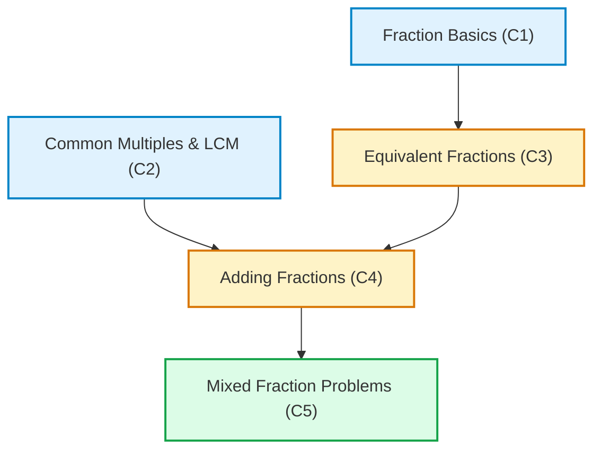

# ShikshaIQ — Product & Architecture Context

**Product Name:** ShikshaIQ  
**Tagline:** One classroom. Different learners. Personalized learning for everyone.  
**Domain:** Adaptive Learning Platform for Indian School Education (Classes 6–10)  
**Initial MVP Target:** Class 7 Mathematics — Fractions  

---

## 1. Executive Summary & Vision

In typical Indian school classrooms, a single teacher instructs 40 to 60 students with wide variations in foundational readiness. When teaching higher-order concepts such as adding fractions or solving mixed fraction word problems, teachers often discover too late that individual students struggle not with the current topic, but with unaddressed foundational deficits—such as finding common multiples (LCM) or understanding equivalent fractions.

**ShikshaIQ** bridges this classroom gap by:
1. Administering targeted diagnostic assessments.
2. Using a **transparent, deterministic adaptive engine** to evaluate mastery and map knowledge gaps along a Directed Acyclic Graph (DAG) of prerequisite concepts.
3. Supplying students with personalized learning pathways, remediating prerequisite bottlenecks before advancing.
4. Providing an **AI-powered Socratic Tutor** strictly for conceptual scaffolding and explanations, while maintaining a strict barrier between AI dialogue and deterministic grading/mastery calculation.
5. Equipping teachers with an actionable analytics dashboard that highlights classroom-level bottlenecks, individual student trajectories, and the deterministic rationale behind every recommendation.

---

## 2. Pedagogical Domain & Concept Graph (Class 7 Fractions)

### 2.1 The Problem Space
Under the NCERT / CBSE Class 7 Mathematics curriculum ("Fractions and Decimals", Chapter 2):
- Students must add, subtract, multiply, and divide fractions and mixed fractions.
- A student cannot master **Adding Fractions with unlike denominators** without fluency in **Equivalent Fractions** and **Common Multiples (LCM)**.
- A student cannot solve **Mixed Fraction Problems** without fluency in **Adding Fractions** and converting between improper and mixed forms.

### 2.2 Concept Graph (DAG)


### 2.3 Prerequisite Rules
| Concept ID | Concept Title | Direct Prerequisites | Pedagogical Rationale |
|---|---|---|---|
| `C1` | **Fraction Basics** | None | Foundational understanding of parts of a whole, numerator, and denominator. |
| `C2` | **Common Multiples & Factors** | None | Arithmetic foundation: finding multiples, least common multiple (LCM), and divisibility. |
| `C3` | **Equivalent Fractions** | `C1` | Understanding that multiplying/dividing numerator and denominator by the same non-zero integer yields identical value. |
| `C4` | **Adding Fractions** | `C2`, `C3` | Unlike denominators require converting to equivalent fractions with common denominator (LCM). |
| `C5` | **Mixed Fraction Problems** | `C4` | Mixed fraction operations require decomposition, improper fraction conversion, and addition algorithms. |

---

## 3. Core Architectural Principles

### 3.1 Strict Separation: Deterministic Mastery Engine vs. AI Tutor
- **The LLM is NEVER the Grader:** LLMs are non-deterministic and hallucination-prone. An LLM must never calculate student mastery scores, decide pass/fail states, or override prerequisite traversal.
- **Deterministic Knowledge Tracing:** Mastery is calculated via transparent, auditable algorithms (e.g., weighted accuracy across difficulty tiers, slip/guess parameter-adjusted mastery, or BKT) running strictly on server-side logic.
- **AI Tutor as Pedagogical Companion:** The LLM's role is strictly confined to:
  - Providing step-by-step Socratic hints.
  - Formulating culturally resonant Indian analogies (e.g., dividing rotis, sharing dosas, measuring cricket pitch lengths).
  - Explaining the *why* behind a specific mistake without revealing the answer outright.

### 3.2 Security, Integrity & Trust
- **Never Trust the Client:** The client never computes score percentages, passes mastery flags, or asserts user roles. The client only submits question responses; the server validates answers, updates database records, and recalculates mastery.
- **Zero Secret Exposure:** Supabase Service Role keys and LLM API keys remain strictly on the server (`process.env`). Only public anon keys are exposed to the browser.
- **Role-Based Row Level Security (RLS):** Database-enforced authorization policies ensure:
  - Students can only view their own attempts and recommendations.
  - Teachers can view data for students enrolled in their assigned classes.
  - Tampering with foreign records is blocked at the database engine level.

### 3.3 Educational Sensitivity & Data Privacy
- Indian school students are minors. Data collection is strictly minimized: only name/alias, class/section, roll number/email, and learning event data are stored.
- No commercial tracking, third-party analytics scripts, or unnecessary personal identifiers.

---

## 4. Technology Stack & Technical Rationale

| Layer | Technology | Version / Specification | Architectural Rationale |
|---|---|---|---|
| **Framework** | Next.js (App Router) | 16.4.3 | Turbopack compilation, React Server Components (RSC), server actions, optimized streaming. |
| **UI Library** | React | 19.3.0 | Modern concurrent rendering, server actions, optimistic UI transitions. |
| **Language** | TypeScript | 5.x | Strict type safety across domain models, assessment contracts, and database records. |
| **Styling** | Tailwind CSS | v4 (`@tailwindcss/turbopack`) | High-performance CSS engine with zero-runtime overhead and cohesive design tokens. |
| **Database** | Supabase (PostgreSQL) | Managed Postgres | Relational integrity, ACID compliance for assessment transactions, JSONB for flexible question metadata. |
| **Auth** | Supabase Auth (`@supabase/ssr`) | Server-side cookie sessions | Secure HTTP-only session cookies, server-side route protection, RLS integration. |
| **AI Integration** | Server-side LLM API | Gemini / OpenRouter / OpenAI SDK | Streaming Socratic guidance, structured system prompts, zero client-side key leakage. |
| **Teacher Analytics** | Recharts | Compatible with React 19 | Responsive, accessible charts (bar charts, mastery distributions, bottleneck graphs). |
| **Offline / PWA** | IndexedDB & Service Worker | Planned (Phase 6) | Caching questions and buffering submissions for erratic internet connectivity in semi-urban/rural schools. |
| **Deployment** | Vercel | Production | Serverless Edge/Node execution, preview deployments, automatic branch builds. |

---

## 4.1 Design System: White & Black Minimal Apple-Like UI

- **Philosophy:** Ultra-clean, high-contrast, distraction-free aesthetic with generous whitespace and Apple-style restrained motion.
- **Color Palette:**
  - Backgrounds: `#ffffff` (pure white) and `#fbfbfd` (light neutral page canvas), with `#f5f5f7` for subtle section contrasts.
  - Text: Deep jet black (`#000000`, `#1d1d1f`) for primary headings, `#6e6e73` for secondary descriptions.
  - Hairline Borders: Crisp `border-black/[0.06]` to `border-black/[0.08]`.
  - Buttons: Solid black pill buttons (`bg-black text-white hover:bg-zinc-800 rounded-full`) and white secondary buttons (`bg-white text-zinc-900 border border-zinc-200/90 rounded-full`).
  - Learning Status Indicators: Clean micro-badges (Emerald for Mastered, Amber for Developing, Rose for Root Gap).
- **Branding:** Minimal monochrome "ShikshaIQ" wordmark with solid black icon squircle.

---

## 5. Architectural Directory Layout

```
shikshaiq/
├── app/                        # Next.js App Router
│   ├── (auth)/                 # Login, signup, password reset
│   ├── (student)/              # Student learning portal
│   │   ├── dashboard/          # Student home & learning path
│   │   ├── diagnostic/         # Diagnostic assessment runner
│   │   ├── learn/[conceptId]/  # Concept lesson & interactive practice
│   │   └── tutor/              # AI Socratic Tutor interface
│   ├── (teacher)/              # Teacher analytics & classroom management
│   │   ├── dashboard/          # Classroom aggregate analytics & bottleneck view
│   │   ├── students/[id]/      # Individual student mastery drill-down
│   │   └── classes/            # Class roster & assignment management
│   ├── api/                    # Server-side API routes (AI tutor, server evaluations)
│   ├── globals.css             # Tailwind v4 theme configuration
│   └── layout.tsx              # Root HTML & font shell
├── components/                 # Reusable UI component library
│   ├── ui/                     # Primitives (button, card, dialog, badge, progress)
│   ├── student/                # Student-facing components (concept cards, quiz UI)
│   ├── teacher/                # Teacher-facing components (analytics charts, gap alerts)
│   └── tutor/                  # Chat drawer, hint widget, math renderer
├── lib/                        # Core business logic (framework-independent)
│   ├── engine/                 # Deterministic adaptive engine
│   │   ├── conceptGraph.ts     # DAG definition, nodes, edges, dependencies
│   │   ├── mastery.ts          # Mastery calculation algorithms & thresholds
│   │   └── recommender.ts      # Prerequisite gap traversal & next-best-action logic
│   ├── ai/                     # Server-side AI Tutor service
│   │   ├── tutorService.ts     # LLM calling logic, context construction
│   │   └── prompts.ts          # Socratic pedagogical prompt templates
│   ├── supabase/               # Supabase client configurations
│   │   ├── client.ts           # Browser-safe client (anon key only)
│   │   ├── server.ts           # Server component / Server Action client
│   │   └── middleware.ts       # Auth session refresh & route protection
│   └── curriculum/             # Class 7 Mathematics curriculum data
│       ├── concepts.ts         # Concept metadata, prerequisites, standards
│       └── questions.ts        # Validated diagnostic & practice question bank
├── types/                      # Central TypeScript interfaces & database schemas
│   ├── database.ts             # Supabase schema definitions
│   ├── curriculum.ts           # Concepts, questions, options, explanations
│   ├── assessment.ts           # Submissions, evaluations, diagnostic results
│   └── engine.ts               # Mastery state, DAG nodes, recommendations
├── docs/                       # Product and architecture documentation
│   ├── SHIKSHAIQ_CONTEXT.md    # Permanent context & architecture (this file)
│   └── SHIKSHAIQ_PHASES.md     # Phased development checklist & status
└── supabase/                   # Database migrations, RLS policies, seed scripts
    └── migrations/
```

---

## 6. Mathematical Evaluation & Anti-Tamper Specification

1. **Question Storage:** Each question in `lib/curriculum/questions.ts` (and database) has a unique ID, concept ID, difficulty level (1 to 3), question prompt, structured options, correct answer key, and pedagogical explanations.
2. **Client Interaction:**
   - The client fetches question prompts and options (without correct answer keys if sensitive, or evaluated on server submission).
   - The client posts `{ questionId, selectedOptionId, timeSpentSeconds }`.
3. **Server Evaluation:**
   - Server validates submission against correct key.
   - Logs result to `student_responses` table.
   - Re-evaluates concept mastery using the deterministic formula:
     $$\text{Mastery}(c) = \frac{\sum (w_i \cdot \text{correct}_i)}{\sum w_i}$$
     where $w_i$ is the weight of question $i$ based on difficulty tier.
   - Updates `student_concept_mastery` record:
     - `UNTESTED`: No attempts recorded.
     - `NEEDS_REMEDIATION`: Mastery $< 0.60$.
     - `DEVELOPING`: $0.60 \le \text{Mastery} < 0.85$.
     - `MASTERED`: $\text{Mastery} \ge 0.85$.
4. **Recommendation Resolution:**
   - For a target concept $C$, if any prerequisite $P \in \text{Prereqs}(C)$ has $\text{Mastery}(P) < 0.85$, the engine flags a **Prerequisite Gap** and recommends remediating $P$ first.
   - Every recommendation provides a deterministic audit string (e.g., *"Recommended Equivalent Fractions because Adding Fractions requires mastery of C3 (Equivalent Fractions), currently at 45%"*).

---

## 7. Teacher & Administrator Governance Architecture

1. **Teacher Access Model:**
   - Teacher registration defaults to `pending_approval` status in `public.profiles`.
   - Access to `/teacher` is blocked by middleware and server actions until an active administrator approves the account in `/admin`.
2. **Classroom Cohort Management:**
   - Teachers create distinct classroom cohorts (e.g. `Class 7-A Mathematics`).
   - Each cohort generates a unique, unguessable 6-character uppercase alphanumeric join code (`ABCDEFGHJKLMNPQRSTUVWXYZ23456789`).
   - Students join via `/student` using `JoinClassroomCard` which executes the secure `enroll_in_classroom` database function.
3. **Teacher Interventions & Pedagogical Overrides:**
   - Teachers can assign customized next learning activities (`learn`, `practice`, `assessment`) with optional notes on `/teacher/students/[studentId]`.
   - Stored in `public.teacher_interventions` and displayed prominently on the student dashboard, while preserving underlying deterministic mastery calculations.
4. **Platform Administration (`/admin`):**
   - Active platform metrics (accounts, cohorts, attempts, questions).
   - Teacher vetting queue with verified approval and rejection rationale (5–250 chars).
   - User account suspension and restoration.
   - Protected curriculum and question bank inspector (reveals answer keys only to verified administrators).
   - Immutable audit trail in `public.audit_logs`.

---

## 8. Phase 06: Socratic AI Tutor Architecture & Pedagogical Guardrails

1. **Socratic Tutoring Philosophy:**
   - The tutor acts as an encouraging, patient guide for Class 7 Mathematics (NCERT Fractions).
   - Instead of dispensing answers, it asks Socratic questions and breaks problems down into progressive steps.
   - Anchored in relatable Indian everyday contexts (rotis, cricket runs, gulab jamuns, sharing pocket money).
2. **Provider Abstraction (`lib/tutor/provider.ts`):**
   - Unified interface supporting Google Gemini (`GEMINI_API_KEY`) and OpenAI (`OPENAI_API_KEY`).
   - If unconfigured, the system truthfully displays an unconfigured notice with clear instructions, rather than substituting synthetic chat fallbacks.
   - All model keys and credentials remain strictly on the server; never exposed to browser bundles or client network requests.
3. **Multilingual Pedagogy:**
   - Full native support for English (`en`), Hindi (`hi`), and Marathi (`mr`).
   - Clean, instant in-drawer switcher with Devanagari mathematical terms (e.g., भिन्न, अंश, हर, ल.स.प. / अपूर्णांक, अंश, छेद).
4. **Safety & Integrity Guardrails:**
   - Prompt Injection Defense: System prompts strictly isolate curriculum context from untrusted student text.
   - Answer Key Protection: The tutor endpoint (`/api/tutor`) never queries or exposes `ANSWER_KEYS`.
   - Rate Limiting: Sliding-window rate limiting restricts users to 15 requests per minute.
   - Database Isolation: The AI Tutor cannot alter mastery scores, mark attempts correct, or bypass prerequisites.
   - Persistent History: Stored in `public.tutor_conversations` and `public.tutor_messages` with strict student-level Row Level Security (RLS).

---

## 9. Phase 07: PWA, Offline Learning Architecture & Reliable Synchronization

1. **PWA Foundation & Service Worker:**
   - Standards-compliant Web App Manifest (`app/manifest.ts` & `public/manifest.json`) supporting standalone display mode and Apple minimal branding.
   - Versioned Service Worker (`public/sw.js`, `shikshaiq-v1-static`) with strict Never-Cache rules protecting authenticated API endpoints (`/api/assessment/*`, `/api/practice/*`, `/api/practice/sync`, `/api/tutor`, `/auth/*`, and `supabase.co`).
2. **IndexedDB Local Storage Model (`lib/offline/indexedDb.ts`):**
   - Dedicated client database `shikshaiq_offline_v1` with 4 object stores:
     - `cached_lessons`: approved concept lessons and worked examples.
     - `cached_questions`: public practice question text and options (strictly ZERO answer keys).
     - `pending_attempts`: offline practice answers tagged with student `userId` and client UUIDv4 idempotency keys.
     - `sync_metadata`: per-student queue counts and timestamps.
3. **Multi-User Queue Isolation:**
   - All pending attempts are tied to the authenticated student's `userId`.
   - Upon synchronization, the server verifies `auth.uid() = attempt.userId`. Attempts belonging to another user are never synced.
4. **Authoritative Server-Side Synchronization & Database Idempotency:**
   - Synchronizes via `/api/practice/sync` with batch limit of 20 items.
   - Supabase migration `20261030040000_phase07_offline_sync.sql` enforces unique partial index `idx_student_attempts_idempotency` on `(student_id, idempotency_key)`.
   - Duplicate or retried attempts return `already_processed` without re-inserting or double-counting evidence.
   - Server validates answers against server-side `ANSWER_KEYS` and triggers deterministic concept mastery recalculation through `evaluateAllConceptMasteries`.
5. **Truthful Offline UI & Paused AI Tutoring:**
   - Minimalist `OfflineStatusBar` and `OfflineDownloadButton` provide clean, non-intrusive feedback.
   - When offline, live AI tutoring in `SocraticTutorDrawer` is honestly paused with clear student notices, while previously cached lessons and practice questions remain fully operational.


